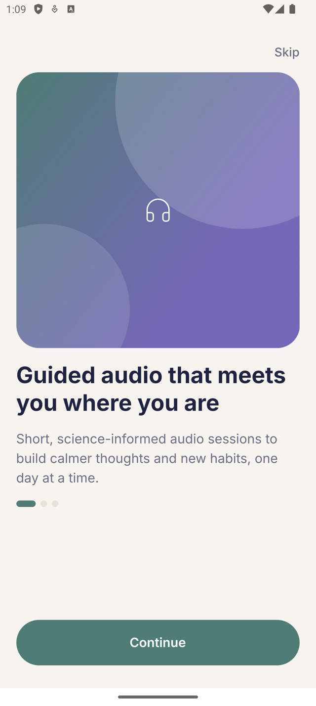
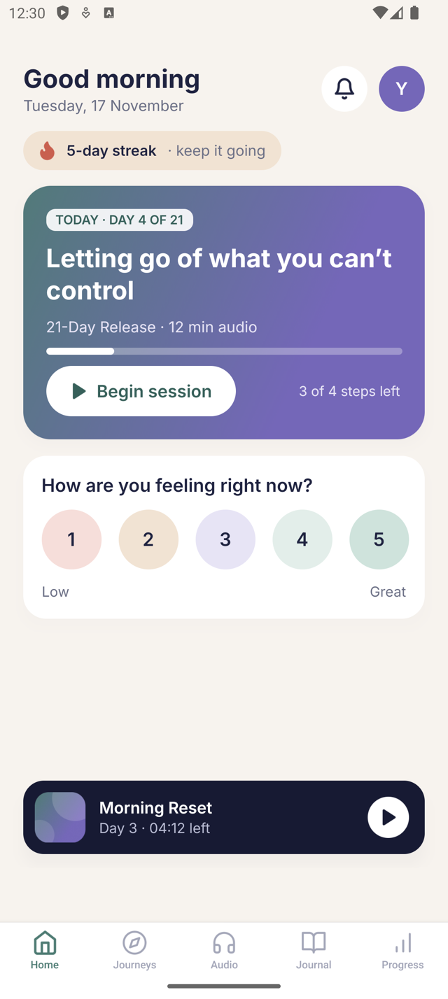
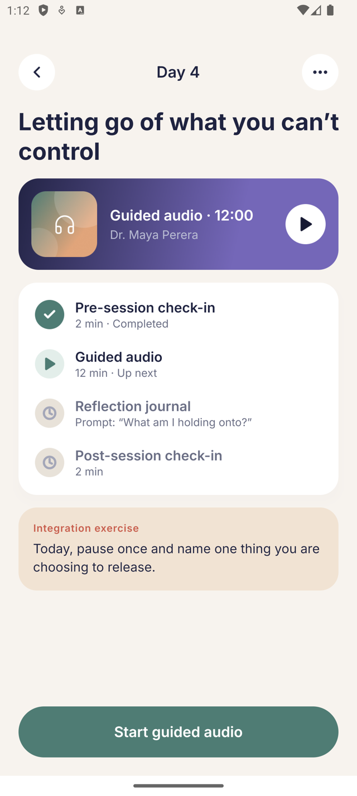
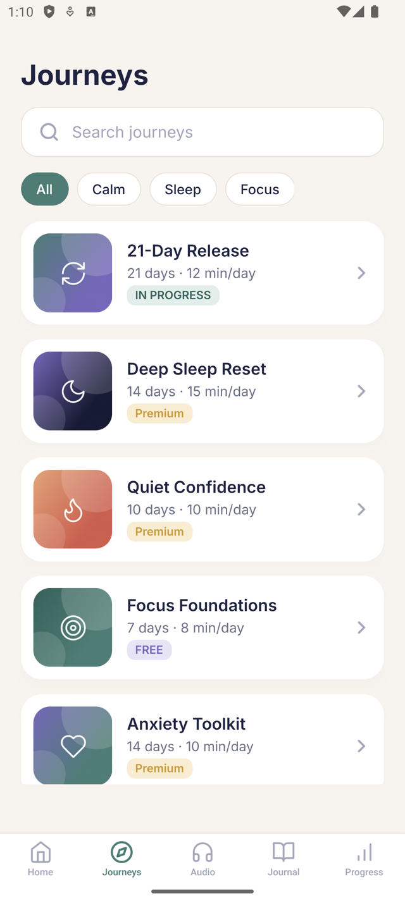
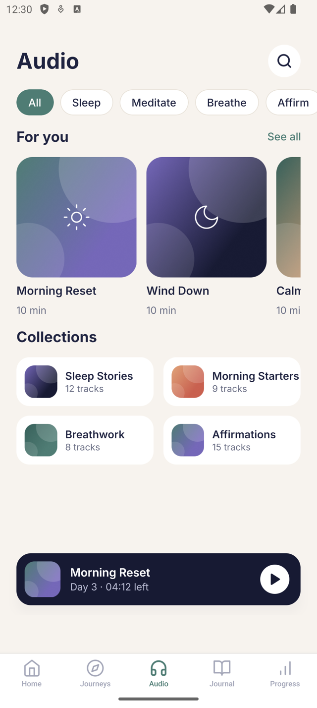
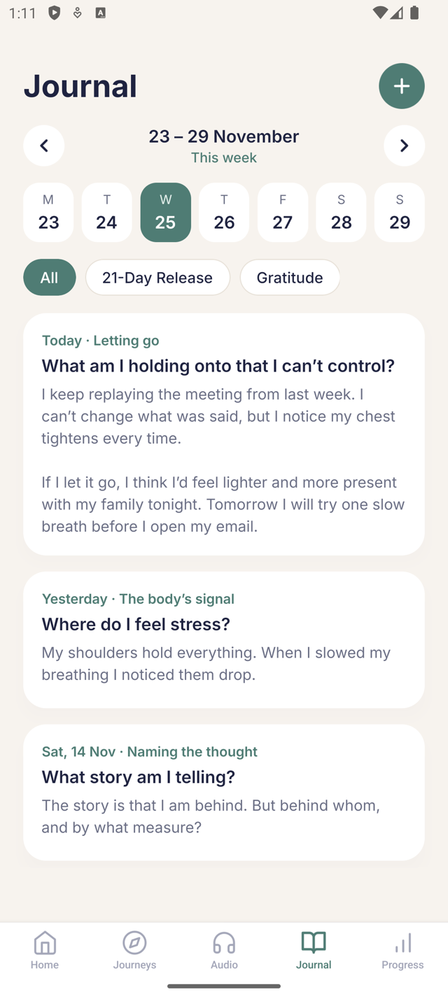

<div align="center">

<a href="https://symplr.io">
  <picture>
    <source media="(prefers-color-scheme: dark)" srcset="docs/symplr-logo-dark.png">
    
  </picture>
</a>

# Stillpoint

**A personal-development app generated by [Symplr.io](https://symplr.io) from a Figma design.**<br>
Real Expo React Native source code, in strict TypeScript, running against a live backend.

<a href="https://symplr.io/demo/personal-development"></a><br>
<sub>Cmd/Ctrl-click to open it in a new tab.</sub>

[](https://sonarcloud.io/summary/overall?id=Symplr-io_personal-development-demo)
[](https://sonarcloud.io/component_measures?id=Symplr-io_personal-development-demo&metric=coverage)
[](https://github.com/Symplr-io/personal-development-demo/actions/workflows/quality.yml)
[](LICENSE)








</div>

## Try it in your browser

Open **[symplr.io/demo/personal-development](https://symplr.io/demo/personal-development)** (Cmd/Ctrl-click for a new tab). No install and no account needed.

1. The page opens on the app's Blueprint, the map of its screens in Symplr.io. Click a screen to see what is on it.
2. Press **Run** to use the app itself.
3. Sign in as `demo@symplr.io` with the password `Demo-oGOPNuE_gFVt`.

It runs on the same demo backend as the phone app below, so it shows the same journal and the same account.
**Build your own with Symplr** gives you a copy of the app to change, once you sign up.

## Try it on your phone


The demo runs in **Expo Go for SDK 58**, on Android.

1. Install Expo Go:
   - from [Google Play](https://play.google.com/store/apps/details?id=host.exp.exponent), or
   - if the Play version has moved past SDK 58, install
     [Expo Go 58.0.5 (APK)](https://github.com/expo/expo-go-releases/releases/download/Expo-Go-58.0.5/Expo-Go-58.0.5.apk)
     and allow installs from your browser when Android asks.
2. Scan the QR code, or open `exp://demo-personal-development.symplr.io` in Expo Go.
3. Sign in as `demo@symplr.io` with the password `Demo-oGOPNuE_gFVt`.

Start today's session, check in before and after it, browse the journeys and the
audio library, and read or write in the journal.
The demo data resets every 30 minutes. Expo Go on iPhone cannot open it yet.

<br clear="right">

## Made with Symplr.io

<p align="center">
  
  &nbsp;→&nbsp;
  
  &nbsp;→&nbsp;
  
</p>

Symplr.io turned the Figma design into the app in [`apps/personal-development`](apps/personal-development):

- **31 screens** from the Figma frames, with navigation, tabs and deep links.
- **A typed data layer:** TanStack Query hooks, Zod-checked responses, and
  Supabase Auth and PostgREST behind them.
- **Design tokens** taken from Figma, with NativeWind for code you add.
- **Quality built in:** 873 unit tests, ESLint, strict TypeScript, and the
  CI and SonarQube Cloud setup.

A few small fixes were made by hand after generation. Each one is its own
commit in the history.

**Have a design of your own? [Turn it into an app at symplr.io →](https://symplr.io)**

## For developers


Run it yourself with Node 22 and Expo Go:

```bash
git clone https://github.com/Symplr-io/personal-development-demo.git
cd personal-development-demo/apps/personal-development
npm ci
npm start        # then scan the QR code in the terminal with Expo Go
```

The phone and the computer need to be on the same network.

The app uses the demo backend in its committed `.env`, so the demo account above works locally too.

| Command | What it does |
| --- | --- |
| `npm start` | Starts the Expo dev server |
| `npm run typecheck` | Type-checks with `tsc` |
| `npm run lint` | Runs ESLint |
| `npm test` | Runs the Jest unit tests |
| `npm run test:coverage` | Runs the tests and writes the coverage report |

| Path | What is there |
| --- | --- |
| [`apps/personal-development`](apps/personal-development) | The app: generated code in `src/gen`, your own code in `src/custom` |
| [`supabase/demo-reset.sql`](supabase/demo-reset.sql) | The app's tables and their row-level security, the sample data and the 30-minute reset |
| [`.github/workflows`](.github/workflows) | The quality checks on every push, and a demo health check every 15 minutes |

## Quality

Every push to `main` runs these checks:

| Type check | Lint | Unit tests | Coverage | SonarQube Cloud |
| :---: | :---: | :---: | :---: | :---: |
| 0 errors | 0 errors | 873 passing | 83% | Quality gate passed, A ratings |

## Credits

The UI comes from the Figma design "Personal Development App – Mobile UI/UX".

The code is released under the [MIT License](LICENSE).
